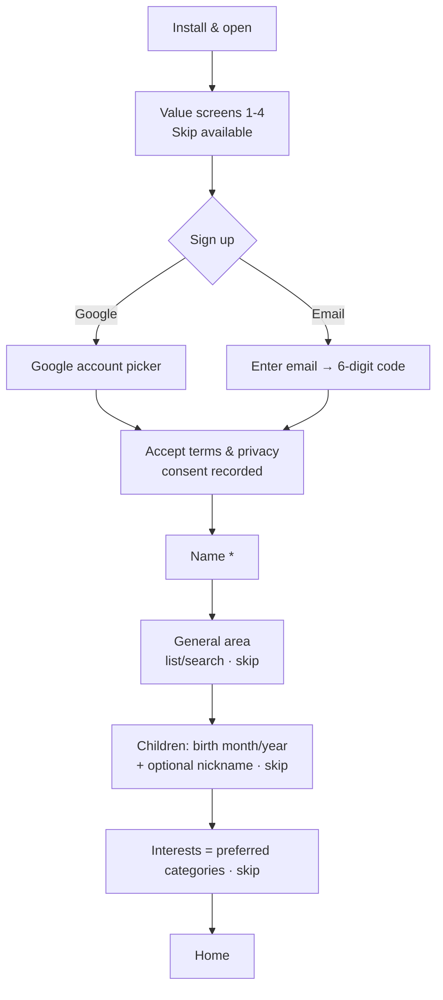

# 02 — UX: User Flows, Information Architecture, Screen Inventory

## 1. Navigation model

Bottom tab bar (5 tabs, consistent everywhere; mirrored in RTL):

| Tab | Icon idea | Root screen |
|---|---|---|
| Home | house | Dashboard |
| Explore | map pin | Map/List of places & classes |
| Checklist | check-square | Outing checklists |
| Community | people | Group directory |
| Profile | person | Profile & settings |

Rules:
- Details screens push on top of the current tab's stack (back gesture returns to the same tab state).
- Modals (filters, add-to-calendar, reminder picker, report) are **bottom sheets** — reachable one-handed.
- Primary actions sit in the lower half of the screen (thumb zone). Sticky action bar on listing details.
- Deep links: `moments://listing/{id}`, `moments://group/{id}`, `moments://checklist/{id}` (+ https App Links later for sharing).

## 2. Information architecture

```
MOMents
├── Onboarding (first launch only)
│   ├── Value 1: Welcome — "Your days out, made easier."
│   ├── Value 2: Activities — "Activities near you."
│   ├── Value 3: Checklists — "Never forget a thing."
│   ├── Value 4: Community — "Find your local mom groups."
│   ├── Sign up / Sign in (Google · Email code) + terms consent
│   └── Personalization: name → area → children → interests
│
├── Home
│   ├── Greeting + child context
│   ├── Happening today near you → Listing details
│   ├── Packing for an outing? → Checklist (new / resume)
│   ├── Your saved classes this week → Listing details
│   └── Groups for you → Group details
│
├── Explore
│   ├── Map view ⇄ List view
│   ├── Search (area/neighborhood; address = should-have)
│   ├── Filters sheet (category, age, distance, day/time, free, open now)
│   ├── Location permission explainer (first visit)
│   ├── Listing details
│   │   ├── Image gallery
│   │   ├── Add to calendar (system UI)
│   │   ├── Directions (Waze / Google Maps chooser)
│   │   ├── Remind me (classes) sheet
│   │   └── Report wrong info sheet
│   └── Suggest a place/class (tip form)
│
├── Checklist
│   ├── My checklists (in progress, recent) + templates
│   ├── New checklist: choose outing type / template → choose children
│   ├── Checklist detail (check items, add/remove, progress, reset, save as template)
│   └── Template editor
│
├── Community
│   ├── Group directory (filters: area, age, interest)
│   ├── Group details → "Join on WhatsApp/Facebook" (external)
│   ├── Report a problem with a group
│   └── (v1.2: in-app groups, posts, playdates)
│
└── Profile
    ├── Profile header (photo, name, area)
    ├── Children (add / edit / remove)
    ├── Saved listings
    ├── My reminders
    ├── My tips (status)
    ├── Checklist templates (shortcut)
    └── Settings
        ├── Language (עברית / English)
        ├── Appearance (System / Light / Dark)
        ├── Notifications (reminders on/off, default lead time)
        ├── Privacy (what we store, preferred categories, export request)
        ├── Account (email, sign out, delete account)
        └── About (terms, privacy policy, contact, version)
```

## 3. Key user flows

### F1 — First launch → Home

Returning user with a valid session → straight to Home. Signed-out returning user → Sign in (value screens skipped).

### F2 — Find something to do today
1. Home → "Happening today near you" card → Listing details, **or** Explore tab.
2. First Explore visit → location explainer ("We use your location only to show what's near you. It's never saved or shown to anyone.") → system permission.
   - Denied → choose an area manually (Explore still works).
3. Map with pins (filters preset: child's age, 3 km, today).
4. Tap pin → bottom card → Listing details.
5. Actions: Directions / Add to calendar / Save / Remind me / Contact.

### F3 — Pack for an outing
1. Checklist tab (or Home quick-start chip "Park").
2. Choose outing type → choose which children are coming (pre-selected if one child).
3. Suggested list appears, grouped (Essentials, Feeding, Clothing, Comfort, Weather) with progress bar.
4. Check items; add custom; remove irrelevant.
5. Done → "Reset for next time" or "Save as template".
6. Works offline throughout.

### F4 — Find a local mom group
1. Community tab → directory filtered by my area + children's ages.
2. Group details → "Join on WhatsApp" → first-time explainer sheet (external platform, its rules apply) → opens WhatsApp.
3. If the link is broken → "Report a problem".

### F5 — Suggest a place/class
Explore empty state / Explore menu / Profile → Tip form → submit → confirmation ("Thanks! We'll check it and add it soon.") → status visible in Profile › My tips.

### F6 — Report wrong info
Listing details → "Report wrong info" → reason (closed, wrong time, wrong price, wrong address, inappropriate, other) + optional note → submitted → admin queue.

### F7 — Delete account
Profile › Settings › Account › Delete account → explainer of what will be deleted → confirm (type DELETE or re-auth) → server deletes data → signed out → onboarding screen.

### F8 — Change language
Settings › Language → choose → "MOMents will restart to apply the language" → app reloads in the new direction.

### Admin flows (web)
- **A1 Quick add listing:** paste address → geocode preview on map → confirm pin → choose kind/category/age/price → add weekly sessions → upload photos → save as Draft → Publish (sets `last_verified_at`).
- **A2 Verify:** "Needs verification" queue (sorted by staleness) → open → check source → "Mark verified" or edit or archive.
- **A3 Review tip:** Tips queue → duplicate check (nearby listings within 100 m shown) → "Create listing from tip" (pre-filled) or decline.
- **A4 Handle report:** Reports queue → open target → fix / dismiss → resolve.
- **A5 Group directory:** add group (link, area, ages, tags, admin consent date) → periodic "check links" queue.

## 4. Screen inventory

Legend — **State coverage** for each screen: Loading · Empty · Error · Offline · RTL · Dark. Every MVP screen must have designs (or rules) for all six.

### Mobile app

| ID | Screen | Purpose | Key components | MVP |
|---|---|---|---|---|
| ON-01 | Splash | Load session/config | Logo | ✅ |
| ON-02..05 | Value screens 1–4 | Explain value | Illustration, headline, body, pager dots, Skip, Next | ✅ |
| AU-01 | Sign up / Sign in | Auth choice | Google button, Email button, legal text | ✅ |
| AU-02 | Email entry | Request code | Email field, Continue | ✅ |
| AU-03 | Code verification | Verify OTP | 6-digit input, resend timer | ✅ |
| AU-04 | Consent | Terms/privacy acceptance | Checkboxes, links | ✅ (may merge into AU-01) |
| PE-01 | Name | Personalize | Text field | ✅ |
| PE-02 | Area | General location | Search list of neighborhoods | ✅ |
| PE-03 | Children | Ages | Month/year picker, nickname, add another | ✅ |
| PE-04 | Interests | Preferred categories | Category chips | ✅ |
| HO-01 | Home | Dashboard | Greeting, card carousels, quick-start chips | ✅ |
| EX-01 | Explore map | Discover | Map, clusters, search bar, filter button, list toggle, locate-me | ✅ |
| EX-02 | Explore list | Discover | Listing cards, sort | ✅ |
| EX-03 | Filters sheet | Narrow results | Chips, segmented controls, distance slider/steps, reset/apply | ✅ |
| EX-04 | Location explainer | Permission priming | Illustration, Allow / Choose area | ✅ |
| EX-05 | Area search | Manual location | Search list | ✅ |
| EX-06 | Listing details | Decide & act | Gallery, info blocks, schedule, mini-map, sticky actions | ✅ |
| EX-07 | Directions chooser | Pick nav app | Waze / Google Maps | ✅ |
| EX-08 | Reminder sheet | Set reminder | Lead time options | ✅ |
| EX-09 | Report sheet | Report wrong info | Reasons, note | ✅ |
| EX-10 | Tip form | Suggest listing | Form | ✅ |
| EX-11 | Image viewer | Full-screen images | Swipe, close | ✅ |
| CL-01 | Checklists home | Start/resume | In-progress, outing-type grid, templates | ✅ |
| CL-02 | Choose children | Personalize suggestions | Child chips | ✅ |
| CL-03 | Checklist detail | Pack | Progress bar, grouped items, add field, menu (reset, save template) | ✅ |
| CL-04 | Template editor | Manage templates | Rename, items, delete | ✅ |
| CO-01 | Group directory | Find groups | Filters, group cards | ✅ |
| CO-02 | Group details | Decide to join | Description, tags, platform, Join, report | ✅ |
| CO-03 | External-link explainer | Safety notice | Text, Continue | ✅ |
| PR-01 | Profile | Personal area | Header, sections | ✅ |
| PR-02 | Edit profile | Edit name/photo/area | Form, image picker | ✅ |
| PR-03 | Children list / edit | Manage children | List, form | ✅ |
| PR-04 | Saved listings | Favorites | Listing cards | ✅ |
| PR-05 | My reminders | Manage reminders | List, toggle | ✅ |
| PR-06 | My tips | Tip status | List with status pills | ✅ |
| ST-01 | Settings | Preferences | Grouped rows | ✅ |
| ST-02 | Language | Switch HE/EN | Radio list | ✅ |
| ST-03 | Appearance | Theme | Radio list | ✅ |
| ST-04 | Notifications | Reminder prefs | Toggles | ✅ |
| ST-05 | Privacy | Data transparency | Text, toggles, export request | ✅ |
| ST-06 | Delete account | Erase data | Explainer, confirm | ✅ |
| ST-07 | About & legal | Legal | Links (open in in-app browser) | ✅ |
| SY-01 | Global error / offline banner | Resilience | Banner, retry | ✅ |
| SY-02 | Force-update screen | Block outdated clients | Message, store link | ✅ |
| NC-01 | Notification center | Inbox | — | ⏳ v1.3 |
| CM-* | In-app groups, feed, post, comments, playdates, blocked users | Community | — | ⏳ v1.2 |

**MVP total: ~45 screens/sheets** (many are small sheets).

### Admin web app

| ID | Screen | MVP |
|---|---|---|
| AD-01 | Sign in (admin role required) | ✅ |
| AD-02 | Dashboard: counts (published, stale, pending tips, open reports) + engagement charts | ✅ |
| AD-03 | Listings table (filters: status, kind, category, area, staleness) | ✅ |
| AD-04 | Listing create/edit (quick add: address → geocode → pin → details → sessions → images) | ✅ |
| AD-05 | Verification queue | ✅ |
| AD-06 | Locations (venues) table / edit | ✅ |
| AD-07 | Organizers table / edit | ✅ |
| AD-08 | Categories & areas management | ✅ |
| AD-09 | Tips queue + "create listing from tip" | ✅ |
| AD-10 | Reports queue | ✅ |
| AD-11 | Group directory management + link-check queue | ✅ |
| AD-12 | Checklist catalog & suggestion rules | ✅ |
| AD-13 | Users (read-only lookup, role management, delete on request) | ✅ (minimal) |
| AD-14 | Audit log | ✅ (read-only) |
| AD-15 | Moderation tools for posts/comments/users | ⏳ v1.2 |
| AD-16 | Organizer submissions | ⏳ v1.3 |

## 5. Design-system requirements for the developer

- **Tokens** exported from Figma variables (colors, spacing, radius, typography, elevation) for **light and dark** modes → one `tokens.json` → generated TypeScript theme. No hard-coded colors or spacing in components.
- **Accessibility:** WCAG 2.1 AA contrast. Current palette checks against Cream `#FFF8F0`:
  - Charcoal `#333333` ✅ (≈ 12:1) — body text.
  - Coral `#FF6B6B` ❌ (≈ 2.6:1) — use as fills/accents only; add a darker "coral-text" token for text/icons (target ≥ 4.5:1).
  - Cool Gray `#9CA3AF` ❌ (≈ 2.4:1) — too light for secondary text; add a darker gray (e.g. around `#6B7280`, verify ≥ 4.5:1).
  - Peach / Powder Blue / Mint — surface and illustration colors, not text.
- Touch targets ≥ 48×48 dp (Android guideline). Support system font scaling up to 200% without clipping.
- **RTL:** use logical properties only (`start`/`end`, `marginStart`), mirror directional icons (back arrow, chevrons), never mirror the map, logos, checkmarks or media controls. Numbers, times and prices stay LTR inside RTL text.
- **Typography:** one family covering Hebrew + Latin (e.g. Rubik/Heebo/Assistant) to keep vertical rhythm consistent across languages.
- **Component primitives** (built once, used everywhere): Button, IconButton, Card, ListingCard, Chip, SegmentedControl, BottomSheet, TextField, Checkbox row, ProgressBar, EmptyState, Skeleton, Toast/Banner, Avatar, Badge (Free, Verified, May be outdated), TabBar.
- **Motion:** subtle, respects the OS "reduce motion" setting.
