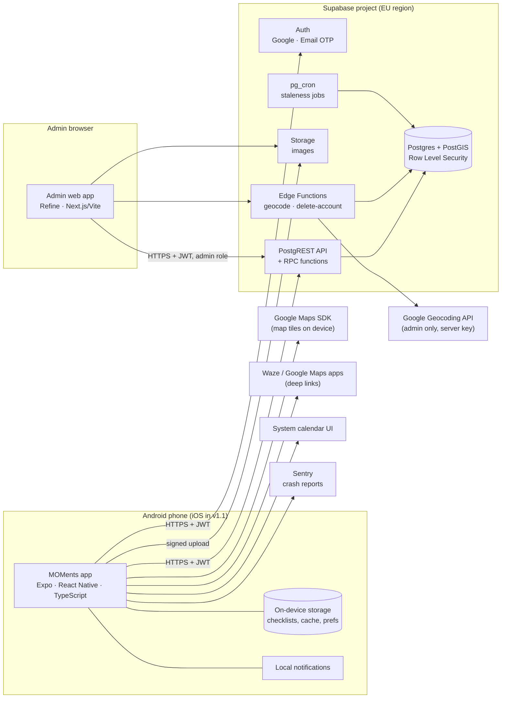

# 03 — Technical Architecture

## 1. Architecture at a glance



**In plain language:** the phone app talks directly to Supabase, which is a hosted Postgres database with login, file storage and small serverless functions included. The database itself decides who may read or change each row (Row Level Security), so even if someone reverse-engineers the app they can only touch their own data. The admin website uses the same database, but only accounts with the admin role can do admin things. Anything that needs a secret key (like geocoding addresses) runs in a server-side Edge Function, never in the app.

## 2. Technology comparison and recommendation

Scores: 1 (poor) – 5 (excellent) **for this team** (1 designer + 1 part-time React/TS developer).

### 2.1 Mobile framework

| Criterion | **React Native + Expo** | Flutter | Native (Kotlin + Swift) |
|---|---|---|---|
| Dev complexity for a React/TS dev | 5 | 2 (learn Dart) | 1 (two codebases) |
| Cost | 5 (free; EAS free tier for builds, verify limits) | 5 | 3 |
| Scalability | 4 | 4 | 5 |
| Maintenance | 4 (Expo SDK upgrades yearly) | 4 | 2 |
| Security | 4 | 4 | 5 |
| RTL / i18n | 4 (I18nManager; needs reload on switch) | 5 | 5 |
| Code sharing with admin web | 5 (TypeScript types, validation, i18n strings) | 1 | 1 |
| **Total** | **31** | 25 | 22 |

**Recommendation: Expo (React Native), TypeScript strict, Expo Router.** Use a development build (not Expo Go) because Google Maps, MMKV and the native Google sign-in need native modules. Use the latest stable Expo SDK at project start.

### 2.2 Backend

| Criterion | **Supabase** | Firebase |
|---|---|---|
| Dev complexity | 4 (SQL needed) | 4 |
| Cost at MVP scale | 4 (Free for dev; Pro $25/mo for prod — free projects pause after 1 week inactive) | 5 (generous free tier, pay per read/write — can spike) |
| Geo queries ("within 3 km, sorted by distance") | 5 (PostGIS, native) | 2 (geohash workarounds) |
| Relational data (users ↔ children ↔ saved ↔ groups ↔ reports; future posts/comments) | 5 | 2 (denormalization) |
| Security model | 5 (RLS in the database, testable with SQL) | 4 (Security Rules) |
| Lock-in / portability | 5 (it's Postgres; can self-host or migrate) | 2 |
| Push / analytics | 3 (use Expo push later; own analytics table) | 5 |
| **Total** | **31** | 24 |

**Recommendation: Supabase**, EU region (closest to Israel, GDPR-aligned).

### 2.3 Maps

| Criterion | **react-native-maps + Google** | Mapbox (`@rnmapbox/maps`) |
|---|---|---|
| Cost | 5 — Google lists mobile Maps SDKs as no-cost SKUs (verify on launch); Places/Geocoding billed per request with per-SKU free caps (10k Essentials / 5k Pro / 1k Enterprise per month) | 3 — billed per monthly active user after the free tier (check mapbox.com/pricing) |
| Custom styling | 3 (JSON styles or cloud Map IDs) | 5 (Mapbox Studio) |
| Hebrew labels / local accuracy in Israel | 5 | 4 |
| Integration effort | 5 | 3 |
| **Total** | **18** | 15 |

**Recommendation: react-native-maps with the Google provider**, lightly styled. Wrap the map in our own `<MapView>` component so a switch to Mapbox later touches one module.

**Cost-control rules:**
- Addresses are geocoded **once, in admin**, via an Edge Function; coordinates are stored. The app never calls Geocoding/Places for listings.
- Area/neighborhood search uses **our own `areas` table**, not Places Autocomplete.
- Free-text address search (should-have) → geocode on submit only (not per keystroke), rate-limited per user.
- API keys restricted: Android key restricted to package name + signing certificate SHA-1; server key restricted to the Geocoding API, never shipped in the app. Billing alerts and daily quota caps set in Google Cloud.

### 2.4 Admin dashboard

| Option | Effort | Fit |
|---|---|---|
| Supabase Studio only | ~0 | Too raw for 150 listings with images, schedules, geocoding |
| **Refine + Supabase data provider** | ~2–3 dev-weeks | CRUD tables/forms out of the box; custom quick-add form where it matters |
| Fully custom | 5+ dev-weeks | Not worth it for one admin user |

**Recommendation: Refine** (React, TypeScript, Ant Design or Mantine UI kit), hosted as a static site. Hosting: Cloudflare Pages / Netlify / Vercel — check each free tier's terms for commercial use (Vercel Hobby is non-commercial).

### 2.5 Other choices

| Concern | Choice | Why |
|---|---|---|
| Navigation | Expo Router (file-based, tabs + stacks) | Standard, deep links for free |
| Server state | TanStack Query | Caching, retries, offline-aware |
| Local state | Zustand | Small, simple |
| Local persistence | MMKV (fast key-value) for prefs/cache + checklist store; outbox queue for sync | Checklist must work offline; simpler than a full sync engine |
| Forms & validation | react-hook-form + Zod (schemas shared with admin) | One source of validation rules |
| Styling | NativeWind (Tailwind for RN) driven by generated design tokens; `dark:` and `rtl:` variants | Designer-friendly naming, dark mode + RTL built in |
| i18n | i18next + react-i18next + expo-localization; ICU plurals; Hebrew default | Proven, supports gendered/plural forms |
| Icons | `phosphor-react-native` (Phosphor, MIT) — matches the Figma icon set | Consistent with design; regular + fill weights |
| Lists | FlashList | Smooth scrolling on mid-range Android |
| Map clustering | supercluster (client-side) | Dataset is small (hundreds of pins) |
| Images | expo-image (caching); uploads resized client-side before upload | Avoids paid image-transformation features |
| Calendar | expo-calendar "create event in calendar" system UI | Avoids requesting full calendar read/write permission (verify API on chosen SDK) |
| Directions | Deep links: `waze://?ll=LAT,LNG&navigate=yes`, `https://www.google.com/maps/dir/?api=1&destination=LAT,LNG` | Free, no API |
| Local reminders | expo-notifications (scheduled local notifications, inexact timing) | No server needed |
| Location | expo-location, foreground only | No background location → simpler store review |
| Crash reporting | Sentry (free developer tier — verify limits), PII scrubbing on | |
| Analytics | Own `analytics_events` table + admin charts | Private, free, enough for MVP metrics. PostHog can be added later |
| Builds & releases | EAS Build + EAS Submit + EAS Update (OTA) | No Mac needed; Android can also be built locally if free-tier build limits bite |
| Monorepo | pnpm workspaces | Share types/validation/i18n between mobile and admin |
| CI | GitHub Actions: typecheck, lint, unit tests, DB tests (pgTAP via Supabase CLI) | |

## 3. Repository structure (proposed)

```
MOMents/
├── apps/
│   ├── mobile/            # Expo app (Expo Router)
│   │   ├── app/           # routes: (onboarding), (auth), (tabs)/home|explore|checklist|community|profile
│   │   ├── src/
│   │   │   ├── components/   # design-system primitives
│   │   │   ├── features/     # explore, checklist, community, profile, auth
│   │   │   ├── lib/          # supabase client, analytics, notifications, location
│   │   │   └── theme/        # generated tokens + theme provider
│   │   └── app.config.ts     # reads env vars; no secrets committed
│   └── admin/             # Refine web app
├── packages/
│   ├── shared/            # Zod schemas, generated DB types, constants (outing types, age buckets)
│   ├── i18n/              # he.json, en.json (+ admin strings)
│   └── tokens/            # tokens.json from Figma → generated TS/Tailwind config
├── supabase/
│   ├── migrations/        # SQL migrations (schema, RLS, functions)
│   ├── functions/         # Edge Functions (geocode, delete-account)
│   ├── seed.sql           # categories, areas, checklist catalog & rules, sample listings
│   └── tests/             # pgTAP tests for RLS policies
├── docs/                  # these planning docs
└── .github/workflows/     # CI
```

## 4. Environments & configuration

| Env | Supabase | App build | Notes |
|---|---|---|---|
| Local | Supabase CLI (Docker) | Dev client | Seed data, fast iteration |
| Staging | Supabase **Free** project | Internal / closed testing track | May pause if inactive — acceptable |
| Production | Supabase **Pro** ($25/mo + usage) | Play Store production | Daily backups, no pausing |

- Public config (Supabase URL, anon key, Maps Android key) via `app.config.ts` + EAS environment variables. The anon key is designed to be public; security comes from RLS.
- Secret config (service-role key, Google server key) **only** in Supabase Edge Function secrets and CI secrets. Never in the repo, never in the app.
- `.env*` files git-ignored; `.env.example` documents variable names.

## 5. API structure

Most data access uses Supabase's auto-generated REST API (via `supabase-js`), protected by RLS. Logic that spans tables or needs geo math lives in Postgres **RPC functions**. Anything needing a secret or elevated rights lives in **Edge Functions**.

### 5.1 Table access (via supabase-js, RLS-enforced)

| Resource | App (authenticated user) | Admin |
|---|---|---|
| `profiles` | read/update own | read all, update roles via `user_roles` |
| `children` | CRUD own | none (not needed) |
| `user_category_preferences` | CRUD own | — |
| `categories`, `areas` | read active | CRUD |
| `activities`, `activity_images`, `activity_schedules`, `schedule_exceptions`, `locations`, `organizers` | read **published** only (via RPCs/views) | CRUD |
| `saved_activities` | CRUD own | aggregate counts only |
| `checklist_catalog_items`, `checklist_suggestion_rules` | read | CRUD |
| `checklist_templates`, `checklist_template_items` | read system + CRUD own | CRUD system |
| `checklists`, `checklist_items` | CRUD own | none |
| `community_groups` | read active | CRUD |
| `activity_tips` | create, read own | read/update all |
| `reports` | create, read own | read/update all |
| `consents` | create/read own | read |
| `analytics_events` | insert own only | read (aggregates) |
| `audit_log` | none | read |

### 5.2 RPC functions (Postgres)

| Function | Input | Output | Notes |
|---|---|---|---|
| `search_activities` | `lat, lng` (client rounds to ~100 m) **or** `area_id`; `radius_m`; `category_ids[]`; `age_months[]`; `day_filter` (today / tomorrow / week / weekday); `time_of_day`; `free_only`; `open_now`; `limit/cursor` | listing summaries + `distance_m` + `next_session_at` | `SECURITY INVOKER`; uses `ST_DWithin` on `geography`; never stores input coordinates |
| `get_activity` | `id` | full details incl. images, schedules, organizer, upcoming sessions (next 4 weeks) | published only |
| `home_feed` | `lat/lng or area_id` | today-near-you, saved-this-week, groups-for-you | one round-trip for Home |
| `upcoming_sessions` | `activity_id, from, to` | expanded session datetimes (applies exceptions, Asia/Jerusalem tz) | used by reminders & calendar |
| `checklist_suggestions` | `outing_type, child_age_months[]` | catalog items with priority | also cached on device for offline |
| `search_areas` | `q, locale` | areas matching HE/EN names and aliases | trigram index |
| `admin_find_nearby_duplicates` | `lat, lng, radius_m` | existing listings | admin only, used in tip review |
| `admin_stats` | date range | counts & engagement aggregates | admin only |

### 5.3 Edge Functions

| Function | Who can call | What it does |
|---|---|---|
| `geocode-address` | admin role | Calls Google Geocoding with server key; returns candidates (lat/lng, formatted address, area guess). Rate-limited; logs usage |
| `geocode-search` (should-have) | authenticated users | Same as above for user address search; strict per-user rate limit; results not stored |
| `delete-account` | the user themself (JWT) | Deletes storage files, rows (cascade), anonymizes analytics, then deletes the auth user (needs service role) |
| `account-deletion-request` (web form backend) | public, captcha | Records a deletion request for users who no longer have the app (Google Play requirement); admin processes it |

### 5.4 Scheduled jobs (pg_cron)

| Job | Schedule | Action |
|---|---|---|
| `mark_stale_activities` | daily | `published` → `stale` when `last_verified_at` exceeds threshold (classes 60 d, places 180 d) |
| `hide_long_stale` | daily | `stale` > 30 days → `archived` (configurable) |
| `group_link_check_queue` | weekly | flags groups not checked in 90 days |
| `purge_old_analytics` | monthly | delete raw events older than 13 months (keep aggregates) |

## 6. Admin dashboard

- Separate deployment, same Supabase project. Admin users are normal auth users with a row in `user_roles` (`admin` or `moderator`).
- **Never** uses the service-role key in the browser. Elevated actions go through RLS policies that check `has_role('admin')`, or through Edge Functions.
- Every insert/update/delete on content tables is written to `audit_log` by database triggers (who, what, when, diff).
- Screens: see [02 — Screen inventory › Admin](02-ux-flows-ia-screens.md#admin-web-app).
- Basic analytics on the dashboard: published listings by status, stale count, pending tips, open reports, weekly active users, top listings by detail views / saves / directions taps, group "join" taps.

## 7. Authentication & authorization strategy

### 7.1 Authentication
| Method | MVP | Implementation |
|---|---|---|
| Google | ✅ | Native Google sign-in on Android (Credential Manager via a maintained RN library) → ID token → `supabase.auth.signInWithIdToken` |
| Email one-time code | ✅ | `signInWithOtp` with 6-digit code (codes are easier than magic links on mobile — no deep-link handling) |
| Apple | v1.1 (iOS) | Required by App Store when other social logins are offered |
| Password | ❌ | Not needed; fewer support issues |

- **Sessions:** Supabase access token (short-lived) + refresh token. Stored encrypted on device: encryption key in `expo-secure-store`, encrypted session blob in MMKV/AsyncStorage (session can exceed SecureStore's size limits — use Supabase's documented "large secure store" pattern).
- Email delivery: configure a custom SMTP provider for production (Supabase's built-in email is rate-limited and meant for development — verify current limits). Check the chosen provider's free tier.
- Auth abuse: Supabase rate limits on OTP; CAPTCHA (e.g. Cloudflare Turnstile/hCaptcha) on the web deletion form.

### 7.2 Authorization
- **Default deny:** RLS enabled on every table; no policy = no access.
- **Ownership:** `owner_id = auth.uid()` (or `user_id`) on all personal tables.
- **Roles:** `user_roles(user_id, role)`; helper `has_role(role)` is a `SECURITY DEFINER` function that reads this table (so a role removal takes effect immediately, unlike JWT claims that persist until token refresh).
- **Public content:** only `status = 'published'` (or `stale`, with badge) rows of listings are readable by users.
- **Anonymous access:** none (sign-up required). The `anon` role gets no table access except the public deletion-request endpoint via Edge Function.
- **Storage buckets:**
  - `activity-images` — public read, admin write.
  - `avatars` — private; read via signed URL by owner (avatars are not shown to other users in MVP); write own folder `avatars/{uid}/…` only; images only, ≤ 2 MB.
- **Edge Functions** verify the JWT and role before acting.

## 8. Offline & sync (checklist)

- Checklists, templates and the suggestion catalog are stored on device. The catalog and rules are refreshed when online (versioned).
- Records use **client-generated UUIDs** and `updated_at`; changes go to an **outbox** that syncs (upsert) when online.
- Conflict rule: last write wins per item (a checklist is personal, so conflicts are rare — e.g. same user on two phones).
- Deletions are soft (`deleted_at`) until synced, then purged.

## 9. Localization architecture

- UI strings in `packages/i18n/{he,en}.json`, keys like `explore.filters.freeOnly`. Hebrew is the default; English fallback for missing keys in dev only (CI fails on missing keys).
- Content fields that admins write are `jsonb` objects: `{ "he": "…", "en": "…" }`; the app shows the user's language and falls back to Hebrew.
- Dates/times via `Intl` with `Asia/Jerusalem`; weekday names and number formats localized; week starts on Sunday in Hebrew locale.
- RTL: `I18nManager.allowRTL(true)`; on language change call `I18nManager.forceRTL(isRTL)` then reload (`expo-updates` `reloadAsync`). All styles use logical properties; a CI lint rule bans `marginLeft/Right`, `paddingLeft/Right`, `left/right` in app code.
- Numeric ranges and times in Hebrew ("0–12", "10:00–10:45") must be bidi-safe: a shared `formatRange()` helper inserts U+200E around the dash; covered by unit tests.
- Gendered Hebrew copy handled by i18next context (`_female`/`_neutral`) so tone can change without code changes.

## 10. Performance & quality budgets

| Metric | Budget |
|---|---|
| Cold start to Home (mid-range Android, e.g. 4 GB RAM) | < 3 s |
| Explore results after filter change | < 1 s for launch dataset |
| JS bundle | monitored per release; no regressions > 10% without reason |
| Crash-free sessions | ≥ 99.5% |
| Accessibility | TalkBack labels on all interactive elements; font scale 200% supported |
