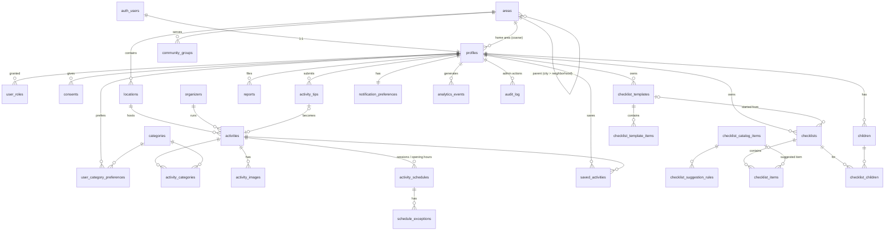
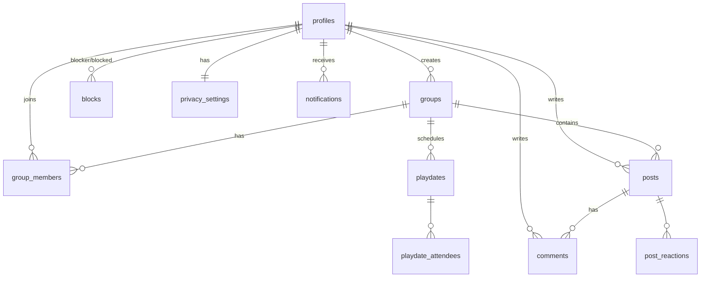

# 04 — Data Model (Supabase / PostgreSQL + PostGIS)

Conventions:
- Primary keys: `uuid` (`gen_random_uuid()`), except lookup tables with `smallint`/`text` keys where noted.
- All timestamps `timestamptz`, stored UTC; business times (class start times) stored as local `time` + IANA timezone (`Asia/Jerusalem`).
- Localized admin-written text: `jsonb` shaped `{"he": "...", "en": "..."}` (type below: `i18n`).
- Geography: `geography(Point, 4326)` with GiST index.
- Every table: RLS **enabled**, default deny. `created_at`, `updated_at` (trigger-maintained) unless noted.
- Enums as Postgres enums (listed in §2).

> The brief listed both "Saved activities" and "Favorites". They are the same thing here → one table, `saved_activities`.
> "Locations" is split into `areas` (city/neighborhood, used for coarse user location and search) and `locations` (exact venue addresses of listings).

## 1. ERD



Future (v1.2+) community tables are in §5 with their own ERD.

## 2. Enums

| Enum | Values |
|---|---|
| `app_role` | `admin`, `moderator` |
| `area_kind` | `city`, `neighborhood` |
| `activity_kind` | `place`, `class` |
| `activity_status` | `draft`, `pending_review`, `published`, `stale`, `archived` |
| `activity_source` | `admin`, `community_tip`, `organizer` |
| `price_type` | `free`, `paid`, `donation`, `varies` |
| `schedule_kind` | `session` (class), `opening_hours` (place) |
| `outing_type` | `park`, `mall`, `doctor`, `short_walk`, `day_trip`, `travel`, `overnight` |
| `tip_status` | `pending`, `accepted`, `declined`, `duplicate` |
| `report_target` | `activity`, `community_group`, `activity_tip` (+ `post`, `comment`, `user` in v1.2) |
| `report_reason` | `wrong_info`, `closed`, `broken_link`, `inappropriate`, `spam`, `safety`, `other` |
| `report_status` | `open`, `resolved`, `dismissed` |
| `group_platform` | `whatsapp`, `facebook`, `telegram`, `other` |
| `group_status` | `active`, `needs_check`, `archived` |
| `consent_doc` | `terms`, `privacy`, `marketing` |

## 3. Tables (MVP)

### 3.1 Users & profile

**`profiles`** — one row per auth user (created by trigger on `auth.users` insert)
| Field | Type | Notes |
|---|---|---|
| `id` | uuid PK, FK → `auth.users.id` ON DELETE CASCADE | |
| `first_name` | text, 1–40 chars | |
| `avatar_path` | text null | path in private `avatars` bucket |
| `area_id` | uuid null FK → `areas.id` | **coarse** location only |
| `locale` | text check in (`he`,`en`) default `he` | |
| `theme` | text check in (`system`,`light`,`dark`) default `system` | |
| `onboarding_completed_at` | timestamptz null | |
| `created_at`, `updated_at` | timestamptz | |

Permissions: owner select/update; insert only via trigger; admin select (support). Never readable by other users in MVP.

**`children`**
| Field | Type | Notes |
|---|---|---|
| `id` | uuid PK | |
| `parent_id` | uuid FK → `profiles.id` ON DELETE CASCADE | |
| `birth_year` | smallint check 2015..current year | |
| `birth_month` | smallint check 1..12 | no exact day stored |
| `nickname` | text null, ≤ 20 chars | private, optional |
| `created_at`, `updated_at` | | |

Permissions: owner only (CRUD). **No admin read policy** — admins don't need it. Age in months computed in queries/app.

**`user_category_preferences`** — PK (`user_id`, `category_id`); owner CRUD.

**`user_roles`** — PK (`user_id`, `role`); `granted_by` uuid, `granted_at`. Select: self (to know own role) + admin. Insert/delete: admin only. Bootstrap the first admin via a migration/SQL editor.

**`consents`**
| Field | Type |
|---|---|
| `id` | uuid PK |
| `user_id` | uuid FK → profiles ON DELETE CASCADE |
| `document` | `consent_doc` |
| `version` | text (e.g. `2026-11-v1`) |
| `accepted_at` | timestamptz |
| `revoked_at` | timestamptz null |
| `app_version`, `locale` | text |

Permissions: owner insert/select; no update except setting `revoked_at`; admin select.

**`notification_preferences`** — PK `user_id`; `activity_reminders` bool default true; `default_lead_minutes` smallint default 60; `product_updates` bool default false. Owner CRUD. (Reminders themselves are scheduled on the device in MVP; this table syncs the preference.)

### 3.2 Geography

**`areas`** (public reference data)
| Field | Type | Notes |
|---|---|---|
| `id` | uuid PK | |
| `slug` | text unique | `tel-aviv/florentin` |
| `kind` | `area_kind` | |
| `parent_id` | uuid null FK → areas | neighborhood → city |
| `name` | i18n jsonb | |
| `aliases` | text[] | alternate spellings, HE/EN |
| `centroid` | geography(Point) | used when user picks an area instead of GPS |
| `boundary` | geography(MultiPolygon) null | optional; for "is this listing in area" |
| `is_launch_area` | bool | controls what's selectable |
| `sort_order` | smallint | |

Permissions: authenticated select where active; admin CRUD. Indexes: GiST on `centroid`, trigram on names.

**`locations`** (venues — exact addresses of businesses/public places, not of users)
| Field | Type | Notes |
|---|---|---|
| `id` | uuid PK | |
| `name` | i18n jsonb | e.g. community center name |
| `address` | i18n jsonb | formatted address |
| `area_id` | uuid FK → areas | |
| `geo` | geography(Point) not null | from admin geocoding + manual pin adjust |
| `google_place_id` | text null | for reference only |
| `accessibility_notes` | i18n jsonb null | |
| `created_by` | uuid FK → profiles | |

Permissions: authenticated select (only via published activities' RPC); admin CRUD.

### 3.3 Activities (places & classes)

**`categories`**
| Field | Type |
|---|---|
| `id` | smallint PK (identity) |
| `slug` | text unique (`sensory`, `music`, `playground`…) |
| `name` | i18n jsonb |
| `icon` | text (design-system icon key) |
| `applies_to` | `activity_kind[]` |
| `sort_order` | smallint |
| `is_active` | bool |

Seed: baby classes, sensory, music, development workshops, parent-and-baby meetups, playgroups, community center, mall activities, parks & playgrounds, toddler activities, free community programs, baby-friendly cafés, nursing/changing rooms.

**`organizers`**
| Field | Type | Notes |
|---|---|---|
| `id` | uuid PK | |
| `name` | i18n jsonb | |
| `description` | i18n jsonb null | |
| `website`, `instagram`, `facebook` | text null | |
| `phone`, `whatsapp`, `email` | text null | **business** contact only |
| `is_verified` | bool | admin confirmed with organizer |
| `owner_user_id` | uuid null FK → profiles | reserved for v1.3 organizer portal |
| `plan` | text null | reserved for monetization |

Permissions: authenticated select public fields (via RPC); admin CRUD.

**`activities`**
| Field | Type | Notes |
|---|---|---|
| `id` | uuid PK | |
| `kind` | `activity_kind` | place / class |
| `title` | i18n jsonb | |
| `description` | i18n jsonb | |
| `location_id` | uuid FK → locations | |
| `organizer_id` | uuid null FK → organizers | |
| `min_age_months`, `max_age_months` | smallint null, check min ≤ max | null = any |
| `price_type` | `price_type` | |
| `price_from_ils` | numeric(8,2) null | |
| `price_note` | i18n jsonb null | "punch card 10 sessions" |
| `registration_url` | text null | |
| `contact_phone`, `contact_whatsapp` | text null | override organizer |
| `amenities` | text[] | `changing_table`, `nursing_room`, `stroller_access`, `shade`, `toilets`, `parking`, `indoor` |
| `requires_registration` | bool | |
| `status` | `activity_status` default `draft` | |
| `source` | `activity_source` | |
| `source_tip_id` | uuid null FK → activity_tips | |
| `source_reference` | text null | where the admin verified it (URL/phone call note) — admin only |
| `last_verified_at` | timestamptz null | set on publish/verify |
| `verified_by` | uuid null FK → profiles | |
| `is_sponsored` | bool default false | reserved |
| `sponsored_until` | timestamptz null | reserved |
| `search_text` | tsvector generated | HE + EN title/description |
| `created_by` | uuid FK → profiles | |
| `created_at`, `updated_at`, `published_at` | | |

Permissions: authenticated select where `status in ('published','stale')`; admin full CRUD. Users never see `source_reference`/`verified_by` (exposed only through RPCs that select public columns, or via a `public_activities` view).

**`activity_categories`** — PK (`activity_id`, `category_id`); `is_primary` bool (exactly one primary per activity, enforced by partial unique index).

**`activity_images`**
| Field | Type |
|---|---|
| `id` | uuid PK |
| `activity_id` | uuid FK ON DELETE CASCADE |
| `storage_path` | text (bucket `activity-images`) |
| `alt` | i18n jsonb |
| `credit` | text null (photographer/organizer permission) |
| `width`, `height` | int |
| `sort_order` | smallint |

**`activity_schedules`** — weekly recurrence (covers ~all classes and opening hours)
| Field | Type | Notes |
|---|---|---|
| `id` | uuid PK | |
| `activity_id` | uuid FK ON DELETE CASCADE | |
| `kind` | `schedule_kind` | |
| `weekday` | smallint 0–6 (0 = Sunday) | |
| `start_time`, `end_time` | time | local time |
| `timezone` | text default `Asia/Jerusalem` | |
| `valid_from` | date | season/term start |
| `valid_until` | date null | term end |
| `age_min_months`, `age_max_months` | smallint null | per-session override (e.g. 0–6 m group at 10:00, 6–12 m at 11:00) |
| `notes` | i18n jsonb null | |

**`schedule_exceptions`**
| Field | Type |
|---|---|
| `id` | uuid PK |
| `schedule_id` | uuid FK ON DELETE CASCADE |
| `date` | date |
| `is_cancelled` | bool |
| `override_start`, `override_end` | time null |
| `note` | i18n jsonb null |

> One-off dated events (v1.3) can be added as `activity_schedules` rows with `valid_from = valid_until`, or an `activity_events` table — no breaking change.

**`saved_activities`**
| Field | Type |
|---|---|
| `user_id` | uuid FK → profiles ON DELETE CASCADE |
| `activity_id` | uuid FK → activities ON DELETE CASCADE |
| `reminder_lead_minutes` | smallint null (null = no reminder) |
| `created_at` | timestamptz |
PK (`user_id`, `activity_id`). Owner CRUD. Admin: aggregate counts only via `admin_stats` RPC.

### 3.4 Tips, reports, directory

**`activity_tips`**
| Field | Type | Notes |
|---|---|---|
| `id` | uuid PK | |
| `submitted_by` | uuid FK → profiles ON DELETE SET NULL | keeps tip if user deletes account, but de-identified |
| `kind` | `activity_kind` | |
| `name` | text ≤ 120 | |
| `category_id` | smallint null FK | |
| `address_text` | text null ≤ 200 | |
| `area_id` | uuid null FK | |
| `link` | text null | |
| `notes` | text ≤ 1000 | |
| `status` | `tip_status` default `pending` | |
| `reviewed_by`, `reviewed_at` | | |
| `resulting_activity_id` | uuid null FK → activities | |
| `admin_note` | text null | not visible to user |

Permissions: insert own (with rate-limit check in policy/trigger: ≤ 5 per 24 h); select own (excluding `admin_note`, via view); admin all.

**`reports`**
| Field | Type |
|---|---|
| `id` | uuid PK |
| `reporter_id` | uuid FK → profiles ON DELETE SET NULL |
| `target_type` | `report_target` |
| `target_id` | uuid |
| `reason` | `report_reason` |
| `details` | text ≤ 1000 |
| `status` | `report_status` default `open` |
| `resolved_by`, `resolved_at`, `resolution_note` | |

Permissions: insert own (rate-limited); select own (status only); admin/moderator all. Unique index on (`reporter_id`, `target_type`, `target_id`) where `status='open'` to prevent spam duplicates.

**`community_groups`** (directory of external groups)
| Field | Type | Notes |
|---|---|---|
| `id` | uuid PK | |
| `name` | i18n jsonb | |
| `description` | i18n jsonb null | |
| `platform` | `group_platform` | |
| `join_url` | text | validated host per platform (chat.whatsapp.com, facebook.com, t.me) |
| `area_id` | uuid null FK | null = city-wide |
| `min_child_age_months`, `max_child_age_months` | smallint null | |
| `tags` | text[] | `first_time`, `maternity_leave`, `weekend`, `working_moms`, `english_speaking`… |
| `approx_members` | int null | admin-entered |
| `admin_consent_at` | timestamptz not null | group admin agreed to be listed |
| `admin_contact_note` | text null | admin-only |
| `last_checked_at` | timestamptz | |
| `status` | `group_status` | |
| `sort_weight` | smallint | |

Permissions: authenticated select active rows (public columns via view); admin CRUD.

### 3.5 Checklists

**`checklist_catalog_items`** (system item library)
| Field | Type |
|---|---|
| `key` | text PK (`diapers`, `wipes`, `sunscreen`…) |
| `label` | i18n jsonb |
| `group` | text (`essentials`, `feeding`, `clothing`, `comfort`, `weather`, `documents`, `sleep`, `health`) |
| `icon` | text |
| `is_active` | bool |

**`checklist_suggestion_rules`**
| Field | Type | Notes |
|---|---|---|
| `id` | uuid PK | |
| `item_key` | text FK → catalog | |
| `outing_type` | `outing_type` | |
| `min_age_months`, `max_age_months` | smallint null | |
| `months_of_year` | smallint[] null | e.g. sunscreen in Apr–Oct (Israel) |
| `priority` | smallint | ordering; ≥ 80 = "essential" |
| `quantity_hint` | i18n jsonb null | "2–3 per hour out" |

Permissions (both catalog tables): authenticated select; admin CRUD. Cached on device with a version number.

**`checklist_templates`**
| Field | Type | Notes |
|---|---|---|
| `id` | uuid PK | client-generated allowed |
| `owner_id` | uuid null FK → profiles ON DELETE CASCADE | null = system template |
| `name` | text (user) / i18n via `system_name` jsonb (system) | |
| `outing_type` | `outing_type` null | |
| `updated_at`, `deleted_at` | | sync support |

**`checklist_template_items`** — `id`, `template_id` FK CASCADE, `item_key` null FK catalog, `custom_label` text null (check: exactly one of `item_key`/`custom_label`), `sort_order`, `updated_at`, `deleted_at`.

**`checklists`** (an outing instance)
| Field | Type |
|---|---|
| `id` | uuid PK (client-generated) |
| `owner_id` | uuid FK → profiles ON DELETE CASCADE |
| `template_id` | uuid null FK |
| `outing_type` | `outing_type` |
| `title` | text null |
| `completed_at` | timestamptz null |
| `created_at`, `updated_at`, `deleted_at` | |

**`checklist_children`** — PK (`checklist_id`, `child_id`), both CASCADE. Owner only.

**`checklist_items`**
| Field | Type |
|---|---|
| `id` | uuid PK (client-generated) |
| `checklist_id` | uuid FK CASCADE |
| `item_key` | text null FK catalog |
| `custom_label` | text null ≤ 60 |
| `is_checked` | bool |
| `from_suggestion` | bool |
| `sort_order` | smallint |
| `updated_at`, `deleted_at` | |

Permissions: owner CRUD (through parent ownership check: `exists (select 1 from checklists c where c.id = checklist_id and c.owner_id = auth.uid())`). System templates: readable by all authenticated, writable by admin.

"Frequently used items" = view `my_frequent_custom_items` (top custom labels by count across the user's checklists) — `SECURITY INVOKER`, so RLS applies.

### 3.6 Analytics & audit

**`analytics_events`**
| Field | Type | Notes |
|---|---|---|
| `id` | bigint identity PK | |
| `user_id` | uuid null | set null on account deletion |
| `session_id` | uuid | random per app session |
| `name` | text check in allow-list | `activity_viewed`, `activity_saved`, `directions_tapped`, `calendar_added`, `contact_tapped`, `registration_tapped`, `reminder_set`, `group_join_tapped`, `checklist_started`, `checklist_completed`, `tip_submitted`, `search_performed` |
| `activity_id` | uuid null | |
| `group_id` | uuid null | |
| `props` | jsonb ≤ 1 KB | **no coordinates, no free text** |
| `app_version`, `platform`, `locale` | text | |
| `created_at` | timestamptz | |

Permissions: insert where `user_id = auth.uid()`; no user select; admin select via aggregate RPC only. Partition or purge monthly.

**`audit_log`** — `id` bigint, `actor_id` uuid, `action` text, `table_name` text, `row_id` text, `diff` jsonb, `created_at`. Written by triggers on content tables (`activities`, `locations`, `organizers`, `community_groups`, `categories`, `areas`, tips/reports status changes, `user_roles`). Admin select only; no update/delete for anyone.

## 4. Row Level Security — policy matrix

`own` = row belongs to `auth.uid()`; `pub` = published content; `A` = admin; `M` = moderator.

| Table | Select | Insert | Update | Delete |
|---|---|---|---|---|
| profiles | own, A | trigger | own (not `id`) | via delete-account fn |
| children | own | own | own | own |
| user_category_preferences | own | own | own | own |
| user_roles | own, A | A | A | A |
| consents | own, A | own | own (`revoked_at` only) | — |
| notification_preferences | own | own | own | own |
| areas, categories | all auth (active) | A | A | A |
| locations, organizers | via public RPC/view; A | A | A | A |
| activities (+images, schedules, exceptions, activity_categories) | auth where pub; A all | A | A | A |
| saved_activities | own | own | own | own |
| activity_tips | own (public cols), A | own (rate-limited) | A | A |
| reports | own (status), A, M | own (rate-limited) | A, M | A |
| community_groups | auth where active; A | A | A | A |
| checklist_catalog_items, checklist_suggestion_rules | all auth | A | A | A |
| checklist_templates (+items) | own + system | own (owner_id = self) / A for system | own / A | own / A |
| checklists, checklist_children, checklist_items | own | own | own | own |
| analytics_events | — (A via RPC) | own | — | — |
| audit_log | A | trigger | — | — |

Illustrative policy shapes (design reference, finalized in migrations):

```sql
-- personal data
create policy "children: owner full access" on children
  for all using (parent_id = auth.uid()) with check (parent_id = auth.uid());

-- published content
create policy "activities: read published" on activities
  for select to authenticated using (status in ('published','stale'));

create policy "activities: admin write" on activities
  for all to authenticated using (has_role('admin')) with check (has_role('admin'));
```

**RLS testing:** every policy gets pgTAP tests in `supabase/tests/` covering: owner can, other user cannot, anon cannot, admin can (where intended). CI blocks merges on failure.

## 5. Future schema (v1.2 in-app community) — designed now, not migrated in MVP



| Table | Key fields | Privacy notes |
|---|---|---|
| `groups` | id, name, description, area_id, age range, tags, visibility (`public`/`approval`), created_by | |
| `group_members` | group_id, user_id, role (`member`/`group_admin`), status (`pending`/`active`/`banned`), joined_at | |
| `posts` | id, group_id, author_id, body, image_path, status (`visible`/`hidden`/`removed`), created_at | readable only by active members; hidden from users who blocked/are blocked |
| `comments` | id, post_id, author_id, body, status | same |
| `post_reactions` | post_id, user_id, kind | |
| `playdates` | id, group_id, organizer_id, title, starts_at, **location_id or area_id only** (no home addresses), capacity | public venues only |
| `playdate_attendees` | playdate_id, user_id, status | |
| `blocks` | blocker_id, blocked_id, created_at | enforced in every read policy |
| `privacy_settings` | user_id, show_photo, show_area, show_children_ages (bucketed), allow_messages | defaults = most private |
| `notifications` | id, user_id, type, payload, read_at | |
| `push_tokens` | user_id, token, platform, updated_at | |

Profiles would get a **`public_profiles` view** exposing only fields allowed by `privacy_settings` (first name, optional photo, neighborhood name, child age buckets like "6–12 m") — never `children.nickname`, birth month, email, or exact location.

## 6. Indexing & performance notes
- GiST on `locations.geo`, `areas.centroid`; B-tree on `activities(status)`, `activity_schedules(activity_id, weekday)`, `saved_activities(user_id)`, `checklist_items(checklist_id)`.
- GIN on `activities.search_text`, trigram on `areas.name`/`aliases` (`pg_trgm`).
- Dataset is small (hundreds of listings); `search_activities` can compute next sessions on the fly. Revisit with a materialized "upcoming sessions" table if > 10k listings.
