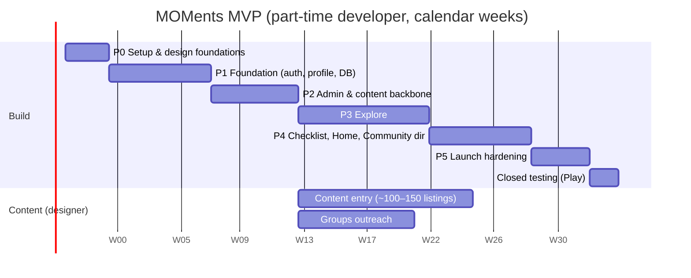

# 06 — Development Roadmap, Complexity & Risks

## 1. Planning assumptions
- Developer: part-time, **~18 h/week ≈ 0.45 FTE**. Estimates below are in **full-time dev-weeks (FTE-wk)** and converted to calendar weeks.
- Designer (you) works in parallel and stays **one phase ahead** of development (designs for phase N+1 ready when phase N starts).
- Content entry (you) starts as soon as the admin tool exists (end of Phase 2) and runs in parallel with Phases 3–4.
- Estimates include tests and code review but not long stalls (vacations, store-review rejections). A 20% buffer is added at the end.

## 2. Phase overview

The original brief put admin in Phase 4. It moves to **Phase 2**: without it there is no content, and without content Explore can't be built or tested with real data.

| Phase | Scope | FTE-wk | Calendar (≈0.45 FTE) | Complexity |
|---|---|---|---|---|
| P0 Setup & design foundations | Repo, CI, environments, tokens pipeline, i18n/RTL skeleton | 1.5 | 3–4 wk | S |
| P1 Foundation | Schema core + RLS, auth, onboarding, profile, children, settings, deletion | 3 | 6–7 wk | M |
| P2 Admin & content backbone | Activities schema, admin app, geocoding, images, schedules, tips/reports/groups admin | 2.5 | 5–6 wk | M |
| P3 Explore | Map/list, filters, search, details, save, calendar, directions, reminders, report, tip form | 4 | 8–9 wk | L |
| P4 Checklist, Home, Community directory | Offline checklist + suggestions, Home feed, directory | 3 | 6–7 wk | M |
| P5 Launch hardening | Analytics, Sentry, a11y, perf, legal, store listing, closed test | 2 | 4–5 wk (+2 wk closed test) | M |
| **Total** | | **16** | **~32–38 wk + 2 wk test ≈ 8–9 months** with buffer | |

> This is a little above the 6–8 months mentioned in chat. Breaking the work down showed the Explore phase and launch requirements (closed testing, legal pages) are larger than they first looked. Ways to bring it back to ~6–7 months are listed in §5.

## 3. Phases in detail

### Phase 0 — Setup & design foundations
**Tasks**
- Monorepo (pnpm workspaces): `apps/mobile` (Expo + Expo Router + TypeScript strict), `apps/admin` (Refine), `packages/shared|i18n|tokens`, `supabase/`.
- CI: typecheck, lint (incl. no-left/right style rule), unit tests, Supabase migration + pgTAP test run.
- Supabase: local CLI, staging (Free) project; production created in P5.
- Google Cloud project, restricted Maps Android key, billing alerts + quotas.
- Google Play developer account (personal), app ID reserved (`com.moments.app` or similar), EAS project, first internal dev build on a real Android phone.
- Design: Figma variables (light + dark) → `tokens.json` → generated theme; font chosen (Hebrew + Latin); app icon draft.
- i18n skeleton (HE default, EN), RTL switching with reload, theme switching.
- Domain + support email.

**Dependencies:** none. **Risks:** native build setup friction (Maps, Google sign-in) — mitigate by proving them in a throwaway screen now.
**Testing:** CI green; dev build installs on device; RTL/LTR toggle works on a sample screen.
**Definition of Done:** a "hello" screen built from tokens renders correctly in HE/RTL + EN/LTR, light + dark, on a physical Android device via EAS build; CI runs on every PR; no secrets in the repo.

### Phase 1 — Product foundation
**Tasks**
- Migrations: `profiles`, `children`, `user_category_preferences`, `user_roles`, `consents`, `notification_preferences`, `areas` (+ seed for launch neighborhoods), `categories` (+ seed), `audit_log`, `has_role()`; RLS + pgTAP tests.
- Auth: Google (native) + email OTP; secure session storage; sign-out; custom SMTP.
- Onboarding: 4 value screens → sign-up → consent → name → area → children → interests.
- Profile: view/edit, avatar upload (resize + strip EXIF), children CRUD.
- Settings: language, theme, notifications prefs (stored), privacy page, about/legal links.
- Account deletion: Edge Function + in-app flow.
- Design-system primitives used so far (Button, TextField, Chip, Card, BottomSheet, EmptyState, Skeleton, Toast).

**Dependencies:** P0. Designs for onboarding/auth/profile/settings.
**Risks:** Google sign-in config (SHA-1 fingerprints differ for dev, EAS and Play signing keys) — document all three; OTP email deliverability.
**Testing:** pgTAP RLS tests (owner/other/anon/admin); unit tests for age calculation; manual test matrix: HE/EN × light/dark × font scale 100/200%; deletion leaves no rows (SQL check).
**Definition of Done:** a new user can sign up with Google or email, complete onboarding, edit profile and children, switch language/theme, and delete the account (verified that all personal rows and files are gone). All tables have RLS with passing tests.

### Phase 2 — Admin & content backbone
**Tasks**
- Migrations: `locations`, `organizers`, `activities`, `activity_categories`, `activity_images`, `activity_schedules`, `schedule_exceptions`, `activity_tips`, `reports`, `community_groups`, `checklist_catalog_items`, `checklist_suggestion_rules` (+ seed), audit triggers, staleness `pg_cron` jobs.
- RPCs: `upcoming_sessions`, `admin_find_nearby_duplicates`, `admin_stats` (basic).
- Edge Function `geocode-address` (server key, rate limit).
- Admin app (Refine): sign-in with admin role + MFA; listings table/filters; **quick add** (address → geocode → draggable pin → details → weekly sessions → images with client-side resize) ; verification queue; organizers; locations; categories & areas; tips queue + "create from tip"; reports queue; groups directory; checklist catalog & rules; audit log view.
- Hosting for admin (static).

**Dependencies:** P1 (auth, roles, areas, categories).
**Risks:** recurring schedule UX in admin (keep to weekly rules + exceptions); Hebrew/RTL in admin UI kit (Refine + Ant Design supports RTL — verify early).
**Testing:** RLS tests (non-admin cannot write; published-only read); unit tests for `upcoming_sessions` incl. DST changes and cancelled dates; admin E2E smoke (Playwright): create → publish → appears in `search` RPC.
**Definition of Done:** you can enter a complete listing (with photos and weekly sessions) in **≤ 5 minutes**, publish it, verify it, and see it go stale on schedule. Tips and reports can be processed end to end. **Content entry starts.**

### Phase 3 — Explore (core MVP)
**Tasks**
- RPCs: `search_activities` (geo + filters + next session), `get_activity`, `search_areas`.
- Explore map (Google provider, light/dark map styles, clustering, locate-me, selected-pin card) and list (FlashList) with shared filter state.
- Location explainer + permission handling + area fallback.
- Filters sheet (category, age defaulting to children, distance, day/time, free, open now).
- Listing details: gallery, schedule, mini-map, organizer, contact/registration, amenities, last-verified badge.
- Save/unsave (optimistic), Saved list in Profile.
- Add to calendar (system UI; single session or weekly), Directions chooser (Waze/Google Maps deep links).
- Local reminders for saved classes (schedule next 4 weeks; reschedule on app open; Android 13+ permission flow).
- Report wrong info sheet; Tip form + My tips.
- Empty/error/offline states.

**Dependencies:** P2 (data + RPCs) and real content in the launch area.
**Risks:** map performance on low-end Android; RTL quirks in map overlays; inexact alarms (reminders may fire a few minutes late — acceptable, communicate "about 1 hour before"); timezone/DST bugs.
**Testing:** unit tests for filter → RPC param mapping; RPC tests with fixture data (distance ordering, age overlap logic, weekday/time filters); manual device tests on a low-end + mid-range Android; RTL screenshot review; accessibility pass with TalkBack.
**Definition of Done:** a user in the launch area can find, filter, open, save, add to calendar, navigate to and set a reminder for a class — in HE and EN, light and dark — with results in < 1 s; works when location is denied.

### Phase 4 — Checklist, Home, Community directory
**Tasks**
- Checklist: local store + outbox sync; outing types; child selection; suggestions engine (rules cached on device); grouped list, progress, add/remove/reorder, reset, save as template, template editor; frequently used custom items (should).
- Migrations: `checklist_templates`, `checklist_template_items`, `checklists`, `checklist_children`, `checklist_items` + RLS tests.
- Home: `home_feed` RPC; greeting with child age; today near you; checklist quick start/resume; saved this week; groups for you.
- Community directory: list + filters + details + external-link explainer + report a problem.

**Dependencies:** P3 (listing cards, search RPC), P2 (catalog/rules, groups data).
**Risks:** offline sync edge cases (duplicates after reconnect) — use client UUIDs + idempotent upserts; suggestion rules quality (you curate the seed data).
**Testing:** unit tests for suggestion engine (age buckets, multiple children union, season rules); offline tests (airplane mode create/edit, reconnect, two devices); E2E happy paths (Maestro for mobile).
**Definition of Done:** checklist fully usable offline and synced without duplicates; Home shows relevant content in < 2 s; directory filters work; all MVP screens implemented with all states.

### Phase 5 — Launch hardening
**Tasks**
- Analytics events (allow-listed) + admin dashboard charts; Sentry with PII scrubbing.
- Accessibility audit (contrast tokens, TalkBack labels, 200% font scale, touch targets).
- Performance pass (cold start, list perf, image sizes).
- Force-update config; production Supabase (Pro) + migrations; backup restore test; Google Cloud quotas.
- Legal: privacy policy, terms, web account-deletion page, Data Safety form, store listing (HE + EN screenshots, description).
- Closed testing track with ≥ required testers for the required days; fix feedback; production release.

**Dependencies:** P1–P4; content ≥ 100 listings; ≥ 10 groups listed.
**Risks:** Play review delays/rejections (permissions disclosure, Data Safety mismatch); not enough closed testers.
**Testing:** full regression on 2–3 devices × HE/EN × light/dark; security checklist from doc 05; RLS test suite; restore drill.
**Definition of Done:** app live on Google Play in the launch area; crash-free ≥ 99.5% in closed test; all doc-05 checklist items ticked or consciously deferred; metrics visible in admin.

## 4. Post-MVP roadmap (future enhancements)

| Version | Scope | Rough size | Trigger to start |
|---|---|---|---|
| v1.1 | **iOS** release + Sign in with Apple; iOS-specific QA; App Store listing | 2–3 FTE-wk | MVP stable; demand from iPhone users |
| v1.2 | **In-app community**: groups, members, posts, comments, reactions, playdates at public venues, block/report, privacy settings, moderation tools in admin, remote push for replies | 6–8 FTE-wk + ongoing moderation | Group-directory join taps show clear demand; moderation capacity exists |
| v1.3 | Remote push notifications & notification center; organizer portal (submissions, own listings); one-off dated events; share links (App Links) | 4–6 FTE-wk | Organizers asking to be listed |
| v1.4 | Personalized recommendations (rule-based first), advanced filters (amenities, indoor/outdoor, weather), saved searches | 3–4 FTE-wk | Enough usage data |
| v2 | Monetization: sponsored/featured listings, organizer subscriptions, partnerships (community centers, malls); expansion to more cities; possibly premium features (never gating core discovery/checklist) | — | Proven retention |
| Later | Location-based "leaving home" checklist reminder (needs background location — high privacy/store cost) | — | Strong user request |

## 5. Ways to shorten the MVP (if needed)

| Cut / simplify | Saves (calendar) | Cost |
|---|---|---|
| List-first Explore; map as a simple non-clustered view | ~2 wk | Less impressive discovery |
| Drop local reminders to v1.1 | ~1 wk | Less retention help |
| Dark mode to v1.1 (tokens stay ready) | ~1–2 wk QA | Less polish |
| Use Supabase Studio for categories/areas/catalog admin; Refine only for listings, tips, reports, groups | ~1–2 wk | Clunkier rare tasks |
| Email OTP only (Google sign-in in v1.1) | ~1 wk | Slower sign-up |

## 6. Estimated development complexity (summary)

| Area | Complexity | Why |
|---|---|---|
| Auth + onboarding + profile | Medium | Standard, but native Google sign-in config and deletion flow take care |
| RTL/i18n + dark mode | Medium | Cross-cutting; cheap if done from day one, expensive if retrofitted |
| Admin app | Medium | Refine reduces CRUD work; quick-add + schedules are custom |
| Geo search + schedules (RPC) | Medium–High | Recurrence + timezone + filters in SQL; heavy testing needed |
| Explore UI (map + list + filters) | High | Most screens, performance on Android, map RTL |
| Checklist offline + sync | Medium | Simple domain, sync edge cases |
| Home | Low–Medium | Composition of existing pieces |
| Community directory | Low | Read-only list |
| Launch (legal, store, testing) | Medium | Non-code work, external dependencies |
| v1.2 Community (future) | High | UGC, moderation, blocking, push, safety |

## 7. Risk register

| ID | Risk | Likelihood | Impact | Mitigation | Owner |
|---|---|---|---|---|---|
| R1 | **Not enough or stale content** — one person maintaining listings | High | High | Small launch area; places + recurring classes only; staleness automation; tips; fast quick-add; see doc 07 | Designer |
| R2 | **Part-time velocity slips** / developer unavailable | High | High | Phases each ship something usable; strict MVP scope; docs + tests reduce bus factor; review progress every 2 weeks | Both |
| R3 | **Google Play closed-testing requirement** for new personal accounts (testers × days) | High | Medium | Recruit ~20 testers early (friends, one mom group); start closed track in P4 | Designer |
| R4 | Third-party pricing changes (Google Maps, Supabase, EAS, Sentry) | Medium | Medium | Map abstraction; admin-only geocoding; quotas + billing alerts; re-verify pricing before launch | Developer |
| R5 | RTL/i18n bugs, especially mixed HE/EN text and map overlays | Medium | Medium | Lint rule for logical styles; RTL screenshot reviews each phase | Both |
| R6 | Timezone/DST bugs in sessions and reminders | Medium | Medium | All recurrence logic in one tested function; DST test cases | Developer |
| R7 | Android reminder reliability (Doze, exact alarm restrictions, OEM battery savers) | Medium | Low | Inexact alarms with "about" wording; refresh on app open | Developer |
| R8 | External WhatsApp groups become spam/unsafe or links break | Medium | Medium | Admin consent required; report button; weekly link checks; quick archive | Designer |
| R9 | Legal non-compliance (Amendment 13, Play Data Safety) | Medium | High | Doc 05 checklist; lawyer review before launch | Designer |
| R10 | Low adoption despite good product | Medium | High | Launch through the listed groups and partners; measure engagement; small area = denser value | Designer |
| R11 | Scope creep (e.g. pulling community forward) | Medium | High | This roadmap + decision log; changes go through a written trade-off | Both |
| R12 | Supabase Free project pauses (staging) | High | Low | Accept for staging; production on Pro | Developer |
| R13 | Image rights for listing photos | Medium | Medium | Own photos or written permission; credit field | Designer |
| R14 | Android-first excludes iPhone users in the target group | Medium | Medium | Collect iOS waitlist emails on the website; v1.1 iOS | Designer |

## 8. Testing strategy (all phases)

| Layer | Tool | What |
|---|---|---|
| Database | pgTAP via Supabase CLI | Every RLS policy; RPC correctness (distance, age, schedule expansion, DST) |
| Unit | Jest / Vitest | Pure logic: age calculation, suggestion engine, filter mapping, date formatting |
| Component | React Native Testing Library | Key components in RTL/LTR, states |
| Mobile E2E | Maestro (verify fit) | Onboarding, find & save listing, checklist offline, delete account |
| Admin E2E | Playwright | Quick add → publish → visible; tip → listing; report resolve |
| Manual matrix | Physical devices | Low-end + mid-range Android × HE/EN × light/dark × font 100/200% |
| Accessibility | TalkBack, contrast checker | Each phase's screens |
| Security | Doc 05 checklist; secret scanning | Before each release |

## 9. Ready to start: approval checklist
- [ ] Decision log in `docs/README.md` confirmed
- [ ] MVP scope (doc 01 §6) approved
- [ ] Stack (doc 03 §2) approved
- [ ] Data model (doc 04) approved
- [ ] Roadmap & timeline (this doc) approved, including the admin-first order
- [ ] Open questions in doc 01 §9 answered or defaults accepted
